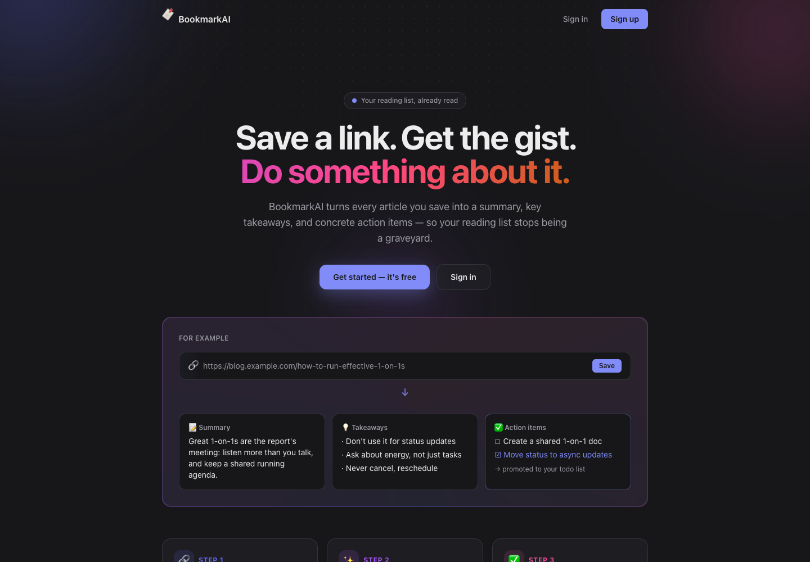
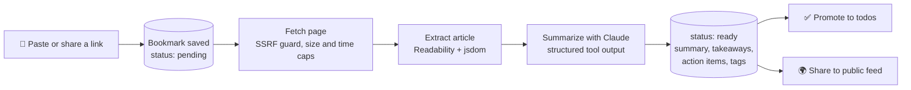

<div align="center">

# 🔖 BookmarkAI

### Save a link. Get the gist. Do something about it.

BookmarkAI turns every article you save into a **summary**, **key takeaways**
and **action items**, then lets you promote those actions straight into a todo
list. Your reading list stops being a graveyard.

[**🌐 Live app**](https://ai-bookmarker.vercel.app) ·
[**✨ Features**](#-features) ·
[**🚀 Self-host**](#-getting-started) ·
[**🔍 How it works**](#-how-it-works)

<br />

[](https://github.com/PrataapMS/ai-bookmarker/actions/workflows/ci.yml)
[](https://github.com/PrataapMS/ai-bookmarker/releases)
[](https://ai-bookmarker.vercel.app)
[](https://github.com/PrataapMS/ai-bookmarker/commits/main)

[](https://nextjs.org/)
[](https://react.dev/)
[](https://www.typescriptlang.org/)
[](https://tailwindcss.com/)
[](https://www.prisma.io/)
[](https://www.postgresql.org/)
[](https://openrouter.ai/)
[](#-sharing-from-your-phone)

<br />

<a href="https://ai-bookmarker.vercel.app">
  
</a>

</div>

---

## 📚 Contents

- [Features](#-features)
- [How it works](#-how-it-works)
- [Tech stack](#-tech-stack)
- [Getting started](#-getting-started)
- [Sharing from your phone](#-sharing-from-your-phone)
- [Project layout](#-project-layout)
- [Deployment and CI/CD](#%EF%B8%8F-deployment-and-cicd)
- [Security](#-security)
- [License](#-license)

> **Note:** signups on the hosted app are invite-only to keep AI costs in
> check. Self-hosting takes a few minutes and is fully open; see
> [Getting started](#-getting-started).

## ✨ Features

### Read less, get more

- **🤖 AI summaries.** Every saved link is fetched, cleaned up and summarized
  by Claude into a short summary, **key takeaways** and **action items**.
- **⏱️ Reading time and read-later queue.** See how long a piece takes and
  mark it read with a small celebration when you're done.
- **🏷️ Auto-tagging.** Claude tags each article by topic; filter your list with
  a searchable tag dropdown.
- **🔁 Smart dedupe.** Saving the same URL twice (even with tracking params)
  reopens the existing bookmark and reuses its summary.

### Turn reading into doing

- **✅ Action items to todos.** Promote any suggested action into a built-in
  todo list with due dates, drag-to-reorder and snooze.
- **🔔 Due-date reminders.** Opt in to push notifications on your phone or
  desktop; mark a todo done or snooze it straight from the notification.
- **📤 Take it anywhere.** Copy a bookmark's summary, takeaways or action items
  as Markdown; export todos as Markdown or CSV, share them, or add one to
  Google Calendar in a tap.
- **⭐ Stars, streaks and surprises.** Star favourites, keep a reading streak
  going, let *Surprise me* pick something from your backlog, and discover
  related reads.

### Share the good stuff

- **🌍 Public feed.** Mark a bookmark public to share it with the community;
  upvotes and downvotes surface the best reads. Feed readers can pull action
  items into their own todos.

### Feels like an app

- **📲 Installable PWA with Android share target.** Tap *Share* in any app and
  pick BookmarkAI; the link is saved and summarized on the spot.
- **📱 Mobile-first navigation.** Bottom tab bar, swipe between sections,
  native-feeling back navigation and view transitions.
- **♾️ Infinite scroll** with a compact/comfortable density toggle.
- **🌗 Light, dusk and dark themes.**
- **⚡ Instant saves.** Bookmarks are stored immediately and processed in the
  background; the page updates itself when the summary is ready.

## 🔍 How it works



1. **Add a link.** A `Bookmark` row is created with `status: "pending"` and
   processing starts in the background via `after()`.
2. **Process it** ([`lib/process-bookmark.ts`](lib/process-bookmark.ts)): fetch
   the URL, extract the article ([`lib/extract.ts`](lib/extract.ts)),
   summarize with Claude ([`lib/summarize.ts`](lib/summarize.ts), forced
   structured output, retried with backoff), then save the result and set
   `status: "ready"` (or `"failed"` with a reason).
3. **Watch it land.** The detail page polls while pending and renders the
   result when it's ready.
4. **Act on it.** Promote action items to your todos, star it, or share it to
   the public feed.

## 🧱 Tech stack

| Layer | Choice |
|---|---|
| **Framework** | Next.js 16 (App Router, server actions, no API routes) + React 19 |
| **Language** | TypeScript |
| **Styling** | Tailwind CSS v4 |
| **Database** | PostgreSQL via Prisma 6 |
| **Auth** | `bcryptjs` password hashing + `jose`-signed JWT session cookie (no third-party provider) |
| **Extraction** | `@mozilla/readability` + `jsdom` |
| **AI** | Claude via [OpenRouter](https://openrouter.ai/), using the OpenAI SDK with structured tool-calling |
| **Hosting** | Vercel (functions in `sin1`), deployed from GitHub Actions |

## 🚀 Getting started

### Prerequisites

- Node.js 20+ (CI uses 24) and npm
- A PostgreSQL database (local, [Neon](https://neon.tech/),
  [Prisma Postgres](https://www.prisma.io/postgres), Supabase, ...)
- An [OpenRouter API key](https://openrouter.ai/keys) for summaries

### Run it locally

```bash
git clone https://github.com/PrataapMS/ai-bookmarker.git
cd ai-bookmarker
npm install
cp .env.example .env        # then fill in .env (see below)
npx prisma migrate deploy   # creates the tables in your database
npm run dev                 # http://localhost:3000
```

Open [http://localhost:3000](http://localhost:3000), create an account and
paste a link.

### Environment variables

| Variable | Required | Purpose |
|---|:---:|---|
| `DATABASE_URL` | ✅ | PostgreSQL connection string (`postgres://...`) |
| `SESSION_SECRET` | ✅ | Long random string for signing sessions: `openssl rand -base64 32` |
| `OPENROUTER_API_KEY` | ✅ | Key from [openrouter.ai/keys](https://openrouter.ai/keys), needed for summaries |
| `OPENROUTER_MODEL` | | e.g. `anthropic/claude-sonnet-5` (quality) or `anthropic/claude-haiku-4.5` (cheaper, faster) |
| `SIGNUP_CODE` | | Invite code that gates signups when set; leave unset for open signup |
| `VAPID_PUBLIC_KEY`, `VAPID_PRIVATE_KEY` | | Push reminder keys: `npx web-push generate-vapid-keys` |
| `VAPID_SUBJECT` | | Contact for push services, e.g. `mailto:you@example.com` |
| `CRON_SECRET` | | Shared secret the reminder scheduler sends: `openssl rand -hex 32` |

> Without `OPENROUTER_API_KEY`, bookmarks are still saved and their text
> extracted, but summarization fails with a clear "not configured" message.

### Scripts

| Command | Description |
|---|---|
| `npm run dev` | Start the development server |
| `npm run build` | `prisma generate` + production build |
| `npm start` | Run the production build |
| `npm run lint` | Lint with ESLint |

## 📲 Sharing from your phone

BookmarkAI is a PWA with a
[Web Share Target](https://developer.mozilla.org/docs/Web/Manifest/share_target),
so your phone's share sheet can hand links straight to it.

**Android (Chrome, Edge, Samsung Internet)**

1. Open the site and choose **Install app** / **Add to Home screen**.
2. In any app, tap **Share** → **BookmarkAI**.
3. The app opens on the new bookmark and the summary fills in as it's
   generated.

Re-sharing a link you already saved just reopens that bookmark; it never
duplicates the entry or pays for a second summary.

**iOS:** Safari doesn't support `share_target`. A Shortcut that opens
`/share?url=[Shortcut Input]` does the same job.

## 📁 Project layout

```text
app/
  page.tsx               # public landing page
  login/                 # sign in / sign up
  actions/               # server actions: auth, bookmarks, todos, lists
  manifest.ts            # PWA manifest + Android share_target
  share/                 # share-sheet target: save the link, open the bookmark
  icon.tsx  icons/       # app icons, generated via next/og
  (app)/                 # signed-in area
    bookmarks/           # list, add form, detail (summary, takeaways, actions)
    starred/             # starred bookmarks
    feed/                # public community feed with voting
    todos/               # todo list
    _components/         # client components (cards, forms, nav, toggles)
lib/                     # auth, extraction, summarization, processing, lists
prisma/
  schema.prisma          # User, Bookmark, Vote, Star, Takeaway, ActionItem, Todo
  migrations/            # applied by the deploy workflow
public/sw.js             # minimal service worker (installability)
```

## ☁️ Deployment and CI/CD

The app runs on **Vercel** with functions pinned to `sin1`, next to the
database. Deploys are driven entirely by GitHub Actions:

| Workflow | When | What it does |
|---|---|---|
| [`ci.yml`](.github/workflows/ci.yml) | Every PR and push to `main` | Lint + build, report the result on Telegram |
| [`reminders.yml`](.github/workflows/reminders.yml) | Every 5 minutes | Calls `/api/cron/reminders` to push due and snoozed todo reminders (needs the `CRON_SECRET` secret) |
| [`deploy.yml`](.github/workflows/deploy.yml) | A push to `main` that bumps the **major or minor** version (patch bumps never deploy), or a manual run | Lint, build, `prisma migrate deploy`, `vercel deploy --prod`, smoke test, tag `vX.Y.Z` with a GitHub Release, post release notes on Telegram |

Production notes:

- Background work in server actions uses `after()` from `next/server` so it
  survives the serverless response lifecycle.
- Pages that trigger fetch + summarize export `maxDuration = 300`.
- Migrations are additive, so the running version keeps working until the new
  deploy lands.

<details>
<summary><b>Repository secrets for your own fork</b></summary>

| Secret | Value |
|---|---|
| `DATABASE_URL` | Production Postgres URL (for migrations) |
| `VERCEL_TOKEN` | [vercel.com/account/tokens](https://vercel.com/account/tokens), scoped to the project's team |
| `VERCEL_ORG_ID`, `VERCEL_PROJECT_ID` | `orgId` and `projectId` from `.vercel/project.json` after `npx vercel link` |
| `TELEGRAM_BOT_TOKEN` | From [@BotFather](https://t.me/BotFather) (`/newbot`) |
| `CRON_SECRET` | Same value as the Vercel env var; enables `reminders.yml` |
| `TELEGRAM_CHAT_ID` | Message the bot, then read `message.chat.id` from `https://api.telegram.org/bot<token>/getUpdates` |

Notifications come from
[`scripts/notify-telegram.mjs`](scripts/notify-telegram.mjs); a notification
problem never fails CI or a deploy.

</details>

## 🔐 Security

- Passwords are hashed with bcrypt; sessions are signed, HTTP-only cookies.
- Link fetching is guarded against SSRF (private and internal addresses are
  refused) and capped by size and time.
- Found a vulnerability? Please report it privately; see
  [SECURITY.md](SECURITY.md).

## 📄 License

Personal project. The source is public for reference; no license is granted
for reuse or redistribution.

<div align="center">
<br />
<sub>Built with Next.js and Claude · <a href="https://ai-bookmarker.vercel.app">ai-bookmarker.vercel.app</a></sub>
</div>
